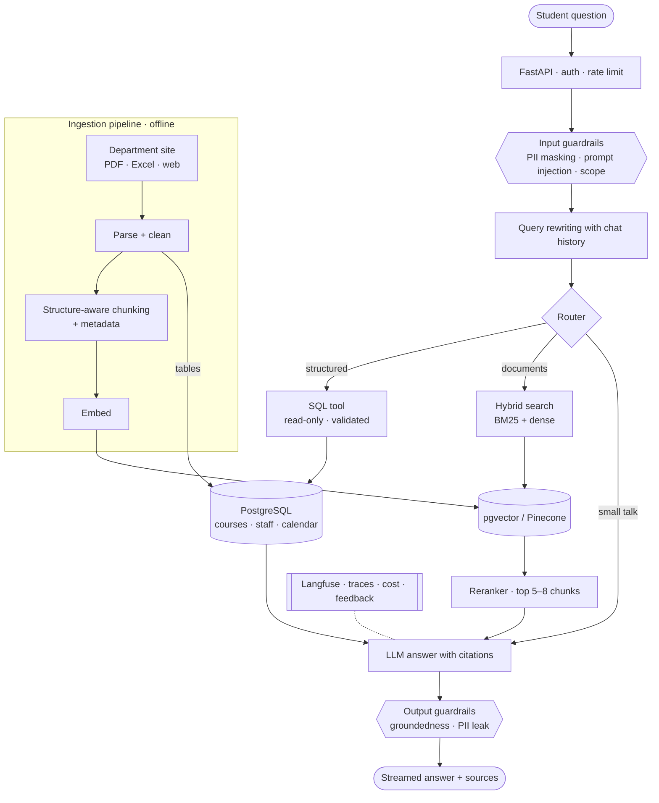

# SAU RAG Assistant

A retrieval-augmented academic assistant that answers Sakarya University Industrial
Engineering students' questions about regulations, internships, curriculum, staff and the
academic calendar — with cited sources and without making things up.

This is v2: a production-oriented rebuild of a low-code (n8n) prototype from my
undergraduate design project. The v1 evaluation showed the bottleneck was ingestion and
retrieval, not the LLM, so v2 is built around measurable improvements there.

> **Status:** Stage 0 — project skeleton. See the [roadmap](docs/roadmap.md).

## v1 baseline (what v2 has to beat)

| Metric | v1 | Notes |
|---|---|---|
| BERTScore F1 | 0.6475 | 15-question test set |
| Retrieval failures | 4 / 15 | answer existed in the knowledge base but was not retrieved |
| Wrong facts | ≥ 2 / 15 | e.g. wrong ECTS value from embedded table data |
| Mean latency | 6.12 s | no streaming |

v1 will be re-scored on the new golden dataset so both versions are compared on the same metrics.

## Planned architecture



| Layer | Choice |
|---|---|
| API | FastAPI, Pydantic v2, SSE streaming |
| Orchestration | LangChain (thin layer; core logic stays framework-independent) |
| Storage | PostgreSQL 16 + pgvector, Redis; Pinecone behind the same interface for comparison |
| Models | Provider-agnostic (Claude / Gemini / OpenAI / open models via Hugging Face) |
| Quality | Golden dataset, retrieval + answer metrics, eval gate in CI |
| Ops | Docker Compose, GitHub Actions, Langfuse |

Decisions are recorded as ADRs in [`docs/adr/`](docs/adr/).

## Getting started

Requirements: [uv](https://docs.astral.sh/uv/), Docker, Python 3.12+.

```bash
cp .env.example .env      # fill in the keys you need
make install              # dependencies + git hooks
make up                   # postgres (pgvector), redis, api
curl localhost:8000/health/ready
```

Run the API on the host instead of in Docker: `make run` (keep `make up` for the datastores
or point `DATABASE_URL` / `REDIS_URL` elsewhere). Interactive docs: http://localhost:8000/docs.

## Development

| Command | What it does |
|---|---|
| `make check` | lint, type check, unit tests, dataset validation (same as CI) |
| `make test-all` | includes integration tests against real Postgres/Redis |
| `make format` | auto-fix and format |
| `make validate-evals` | validate the golden evaluation dataset |
| `make migrate` | apply database migrations (Alembic) |
| `make ingest-dry-run` | process `data/raw/v1-kaynaklar` and write a report to `data/processed/reports/`, no database |
| `make ingest` | migrate, ingest into Postgres (idempotent), write the report |

## Repository layout

```
src/app/
  api/          HTTP routes and schemas
  core/         config, logging, health checks
  ingestion/    parsing, chunking, metadata, incremental indexing
  retrieval/    hybrid search, fusion, reranking, query rewriting
  generation/   prompts, router, tools, cited answers
  guardrails/   input/output safety checks
  storage/      vector store and database adapters
  mcp_server/   MCP server exposing the knowledge base
evals/          golden dataset, schema, evaluation runners
tests/          unit and integration tests
infra/          container and database setup
docs/           roadmap, ADRs, data inventory
```

## Author

Mustafa Enes Yeşilyurt
